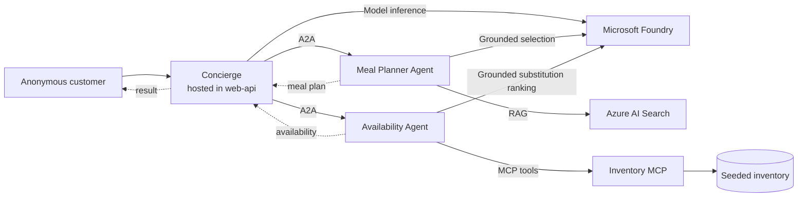

# AKS multi-agent supermarket PoC with Microsoft Entra Agent ID

This proof of concept shows an anonymous customer asking a supermarket concierge for meal ideas and checking whether the ingredients are in stock. Three Python agents collaborate over Agent2Agent (A2A) on Azure Kubernetes Service (AKS) and use one Model Context Protocol (MCP) inventory service. The Concierge is hosted in-process by the public web API; Meal Planner, Availability, and the Inventory MCP run as their own deployments.

> **Identity boundary:** the deployment has four Kubernetes `ServiceAccount`s, four user-assigned managed identities (UAMIs), and three Agent ID blueprints with three Agent IDs. Azure RBAC is assigned to the UAMI; A2A and MCP application roles are assigned to the Agent ID. Inventory MCP is a protected resource with a UAMI but no Agent ID, because it calls no other agent. No credential is shared between agents.

The implemented authorization edges use `MealPlan.Request`, `Availability.Request`, and `Inventory.Read`.

## Scenario

1. The customer supplies preferences, dietary constraints, and serving count without signing in.
2. Concierge uses Microsoft Foundry to extract preferences, constraints, and serving count from the free-text request, then delegates meal planning.
3. Meal Planner uses Foundry to select from Azure AI Search candidates, then validates recipe IDs and scales quantities deterministically.
4. Availability asks Inventory MCP for authoritative stock and candidate substitutes, then uses Foundry to rank only those grounded candidates.
5. Concierge returns the proposed meal, substitutions, availability, and any caveats.

All model responses use strict schemas. Models cannot create recipe IDs, citations,
inventory quantities, SKUs, or substitutions outside the Search and MCP evidence.

The implementation framework is [Microsoft Agent Framework for Python](https://learn.microsoft.com/en-us/agent-framework/overview/).

## Documentation

| Document | Contents |
| --- | --- |
| [Architecture](docs/architecture.md) | Components, trust boundaries, and final Azure/Entra design |
| [Functional flow](docs/functional-flow.md) | Customer journey, A2A/MCP sequence, and contracts |
| [Identity and authentication](docs/identity-authentication.md) | Agent ID theory, the authentication and authorization flows, how this repo implements them, and the PoC deviation register |
| [Security and observability](docs/security-observability.md) | Least privilege, network/data controls, Purview, Defender, and telemetry |
| [Deployment overview](docs/deployment.md) | Provisioning order, configuration model, and validation gates |
| [Microsoft references](docs/references.md) | Current Microsoft Learn links |
| [Diagram assets](docs/diagrams/README.md) | Editable Excalidraw architecture and identity-flow sources |

## Authentication recommendation

Use the **Microsoft Entra ID Auth SDK sidecar** for the supported integration. It performs Agent ID token acquisition and validation over local HTTP and keeps protocol details out of Python application code.

The alternative **direct Python Agent ID protocol adapter is explicitly experimental**. There is currently no first-party, in-process Python Agent ID SDK equivalent for this protocol. A custom adapter must implement the multi-stage Agent ID token exchanges correctly and should not be treated as production-ready until Microsoft publishes supported Python guidance or the implementation passes dedicated security review and conformance tests.

## PoC scope

- Anonymous, non-personalized customer interaction; no user delegated identity or OBO flow.
- Autonomous agent-to-agent and agent-to-tool calls.
- Seeded, read-only inventory; no ordering, payment, or stock mutation.
- The current Azure baseline is implemented in Bicep under `infra/`; Entra Agent ID and app-role automation is implemented by the PowerShell scripts under `scripts/`.
- The current target is a public PoC endpoint backed by AKS. Application Gateway, API Management, a private AKS cluster, and private endpoints are optional future hardening, not current dependencies.
