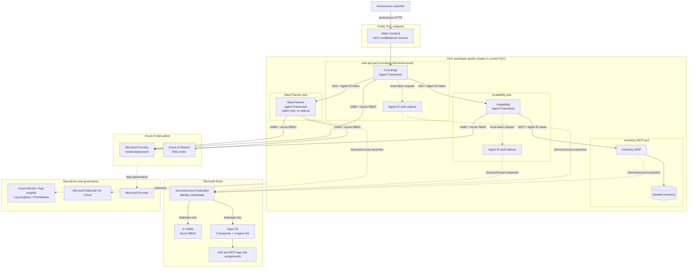
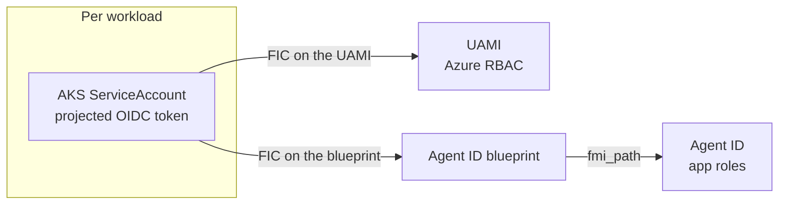

# Solution architecture

## Component model

| Component | Responsibility | Runtime identity |
| --- | --- | --- |
| Concierge Agent | Input validation, orchestration, and final response; hosted in-process by the web API | `concierge` ServiceAccount and UAMI, plus its own blueprint and Agent ID |
| Meal Planner Agent | Selects grounded Search candidates with Foundry, validates source IDs, and scales ingredients deterministically | `meal-planner` ServiceAccount and UAMI, plus its own blueprint and Agent ID |
| Availability Agent | Checks authoritative MCP inventory, uses Foundry to rank grounded substitutes, and revalidates selected SKUs | `availability` ServiceAccount and UAMI, plus its own blueprint and Agent ID |
| Inventory MCP | Exposes read-only inventory tools backed by seeded data | `inventory-mcp` ServiceAccount and UAMI; a protected MCP API with no Agent ID of its own |
| Frontend and web API | Anonymous browser experience, correlation, and public API boundary | Static frontend has no identity; the web API runs under the Concierge ServiceAccount and UAMI because it hosts the Concierge |
| Microsoft Foundry | Model endpoint and agent/model operations | Azure RBAC granted to the calling agent's UAMI |
| Azure AI Search | Recipe/product grounding index | Azure RBAC granted only to Meal Planner UAMI |
| Entra Agent ID | Agent lifecycle, token identity, app-role authorization, auditability | One blueprint and Agent ID per agent |
| Azure Monitor stack | Logs, metrics, distributed traces, dashboards, alerts | Managed ingestion identities and scoped access |

The deployed topology is four ServiceAccounts, four UAMIs, three blueprints, and three Agent IDs. A component needs an Agent ID when it **calls** another agent; it needs a protected API and app roles when it is **called**. See [Identity and authentication](identity-authentication.md) §4.

Agent code uses [Microsoft Agent Framework Python](https://learn.microsoft.com/en-us/agent-framework/overview/). A2A carries agent task messages; MCP exposes typed inventory tools.

## Final Azure and Entra architecture

### Trust boundaries

1. **Internet to public endpoint:** the current PoC exposes only the static frontend through an AKS `LoadBalancer` Service, which proxies the anonymous `/api` calls to the cluster-internal `web-api`. The customer remains anonymous; issue an opaque correlation/session ID, not an identity token.
2. **Public endpoint to agents:** the web API hosting the Concierge, and every downstream agent and MCP service, is a `ClusterIP` Service and requires schema validation, request limits, and service authorization.
3. **Service to service:** Meal Planner, Availability, and Inventory MCP are cluster-internal. Network reachability is necessary but not authorization; validate Entra tokens and required app roles on every A2A/MCP endpoint.
4. **AKS to Azure:** pods obtain UAMI credentials with AKS Workload Identity. Azure resources authorize the UAMI through Azure RBAC.
5. **Identity protocol:** the projected ServiceAccount assertion is the credential presented to a federated identity credential on the blueprint; the resulting Agent ID token identifies the autonomous agent to downstream APIs. The UAMI is a parallel identity for Azure RBAC and is not part of that exchange.

## Identity cardinality

The ServiceAccount token feeds two **parallel** federations, not a chain: one into the UAMI for Azure RBAC, one into the blueprint for Agent ID. A UAMI token is never exchanged for an agent token. Concierge, Meal Planner, and Availability each have this structure; the blueprint-side ServiceAccount federation is provisioned only for Concierge and Availability, the two agents that make outbound calls. Inventory MCP has a ServiceAccount and UAMI but no Agent ID, because it is only ever a callee.

Separate blueprints intentionally favor isolation over blueprint reuse. Compromise, disablement, consent, rotation, and audit remain independently scoped for each agent.

## Authorization map

| Caller | Resource | Authorization |
| --- | --- | --- |
| Concierge, Meal Planner, Availability UAMIs | Foundry account and model deployments | `Cognitive Services OpenAI User`; each agent performs its own bounded inference |
| Meal Planner UAMI only | Azure AI Search index | `Search Index Data Reader`, read/query only |
| All four workload UAMIs | Application Insights | `Monitoring Metrics Publisher` |
| Inventory MCP UAMI | No inference or Search access | Serves seeded local data only |
| Concierge Agent ID | Meal Planner A2A API | `MealPlan.Request` |
| Concierge Agent ID | Availability A2A API | `Availability.Request` |
| Availability Agent ID | Inventory MCP API | `Inventory.Read` |

Each A2A/MCP row pairs two different directory objects: the caller's agent identity (`<prefix>-agent-<slug>`) is *assigned* the role, and a separate protected API application (`<prefix>-api-<slug>`) *defines* the role and the audience. The similar names are not the same object — see [identity-authentication.md §4](identity-authentication.md#4-the-four-identity-planes).

Do not substitute Kubernetes RBAC, network policy, or possession of a UAMI token for app-level A2A/MCP authorization. The two planes are independent: revoking an Azure role does not stop an A2A call, and disabling an Agent ID does not remove Azure data-plane access.

Foundry reasoning is also separated from authoritative data operations. Meal
Planner may select only recipe IDs returned by Search; Python performs serving
arithmetic. Availability may select only candidate SKUs returned by Inventory
MCP; MCP quantities and availability flags are copied without model changes.

## Current versus optional hardening

The checked-in Bicep provisions a public AKS cluster (`enablePrivateCluster: false`) with Azure CNI Overlay, Cilium network policy, and a Standard Load Balancer. It also provisions ACR, monitoring, four workload UAMIs (Concierge, Meal Planner, Availability, and Inventory MCP), Foundry deployments, Azure AI Search, and ServiceAccount-to-UAMI workload identity federation. PowerShell scripts create the Agent ID objects, protected APIs, and exact app-role assignments.

Optional future production hardening includes Application Gateway or API Management, WAF, private AKS, private endpoints/private DNS, controlled egress, and Key Vault integration. None is required to run the public-endpoint PoC.
