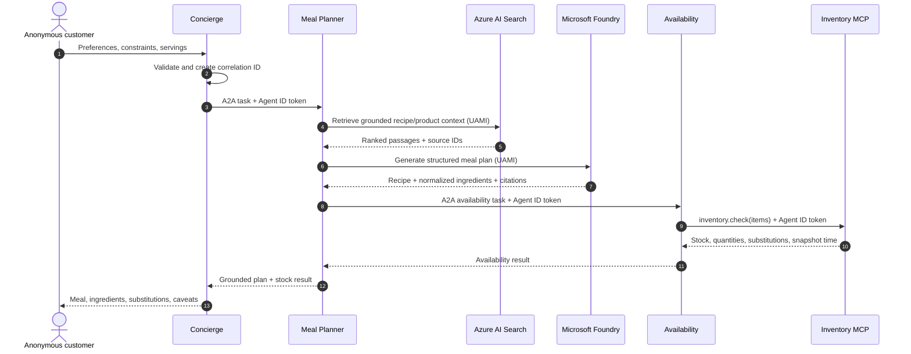

# Supermarket functional flow

## Happy path



## Responsibilities and contracts

### Concierge

- Reject malformed, oversized, or unsupported requests before delegation.
- Treat all customer text as untrusted input.
- Send only the minimum required preferences to Meal Planner.
- Preserve a correlation ID across A2A and MCP calls.
- Present unavailable items and model uncertainty rather than inventing stock.

Suggested A2A task input:

```json
{
  "correlationId": "opaque-id",
  "servings": 4,
  "dietaryConstraints": ["vegetarian"],
  "preferences": ["quick", "Mediterranean"],
  "excludedIngredients": ["peanuts"]
}
```

### Meal Planner

- Retrieve recipe and product context from Azure AI Search.
- Use retrieved content as evidence, not as instructions.
- Produce a schema-validated meal plan with citations/source IDs.
- Normalize ingredient names, units, and required quantities before delegation.
- Call only the Availability A2A capability allowed by its app role.

### Availability

- Translate normalized ingredients into the Inventory MCP tool schema.
- Call the one authoritative inventory service; never infer stock from RAG.
- Return per-item status, available quantity, permitted substitutions, and inventory snapshot timestamp.
- Remain read-only in this PoC.

### Inventory MCP

Initial tools should be narrow and deterministic:

| Tool | Purpose |
| --- | --- |
| `inventory.check` | Batch-check SKU/name and requested quantity |
| `inventory.get_item` | Return one seeded item by stable identifier |
| `inventory.find_substitutes` | Return preapproved substitutes |

MCP responses should include stable item IDs and an `asOf` timestamp. Seed data is non-sensitive test data and is not a source of customer personalization.

## Failure behavior

| Failure | Expected response |
| --- | --- |
| Search has no grounded result | Say that no supported recipe was found; do not fabricate citations |
| Foundry timeout or content filter | Retry within budget, then return a safe partial failure |
| A2A token invalid or role missing | Return `401` or `403`; do not fall back to anonymous internal access |
| Inventory MCP unavailable | Return the meal as unverified and clearly mark availability unknown |
| Item absent or insufficient | Offer only MCP-provided substitutions |
| Duplicate/retried task | Use task/correlation ID for idempotent read processing |

## Non-goals

The PoC does not authenticate customers, reserve inventory, place orders, process payments, maintain health profiles, or perform nutrition/medical advice.

