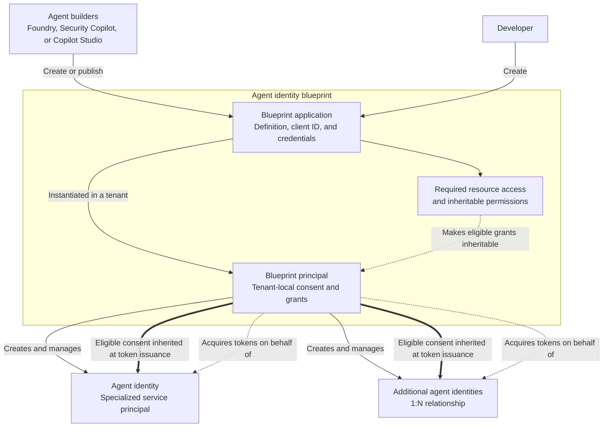
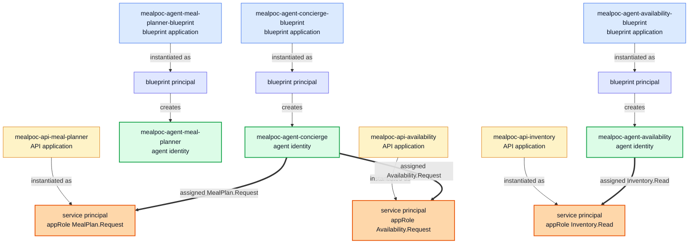
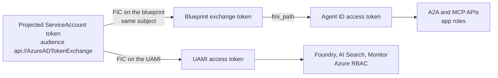
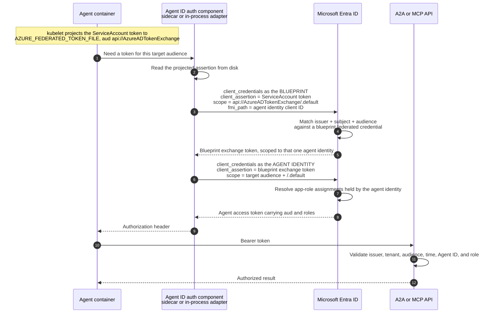
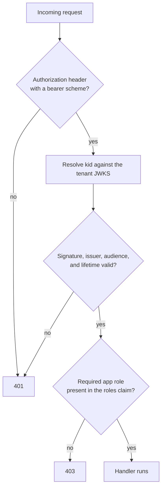

# Identity and authentication

## 1. How to read this document

This document has two jobs: explain **how Microsoft Entra Agent ID works**, and show **how this repository implements it**.

It is written as a *target design*. Every statement describes what a production-oriented implementation should do. Where this proof of concept deliberately or knowingly departs from that target, the text carries a marker such as **(→ D3)** that links to the [PoC deviation register](#12-poc-deviation-register) at the end. Nothing is quietly glossed over: if the code does not do what the theory says, there is a numbered entry for it.

| If you want to… | Read |
| --- | --- |
| Understand what Agent ID is and why it exists | §2, §3 |
| Understand how the identities relate to AKS and Azure | §4 |
| Tell `…-agent-availability` from `…-api-availability` in the tenant | §4 |
| See every Entra object the PoC creates, and how they nest | §4 |
| Follow a token from pod to protected API | §5, §7 |
| Understand how a callee decides to allow the call | §6 |
| Decide how many blueprints and agent identities to create | §8 |
| Find the code that does any of this | §9, §10 |
| Know what is not production-ready yet | §12 |
| Prove it works | §13 |

## 2. Microsoft Entra Agent ID at a glance

[Microsoft Entra Agent ID](https://learn.microsoft.com/en-us/entra/agent-id/what-is-microsoft-entra-agent-id) gives AI agents distinct identities so organizations can authenticate them, grant least-privilege access, apply policy, manage their lifecycle, and attribute their activity. An agent identity is not a renamed app registration or human user account. It is an agent-specific identity built on Microsoft Entra service-principal infrastructure and created from an [agent identity blueprint](https://learn.microsoft.com/en-us/entra/agent-id/agent-blueprint).

Agent builders and developers first define a blueprint for an agent type. The blueprint is the reusable parent and authentication boundary: **it holds the credentials used to authenticate its child agent identities** and can create one or many of them. Children share configuration from the blueprint while retaining their own lifecycle, sponsor, sign-in records, audit identity, and any permissions granted directly to them. They can also receive permissions inherited through the blueprint, as described in §3.

The problem this solves in a system like this one: three cooperating services call each other autonomously, with no human in the loop. Without agent identities, the only things a callee could check are network reachability and a shared workload credential — neither of which answers *"which agent is asking, and is that agent allowed to ask?"*.

## 3. Object model

| Component | High-level role |
| --- | --- |
| Agent identity blueprint application | The reusable definition and credential-bearing authentication boundary for an agent type, including its client ID, metadata, credentials, required resource access, inheritable-permissions configuration, and authentication protocol settings. |
| Agent identity blueprint principal | The tenant-local service principal created when the blueprint application is added to a tenant. It represents the blueprint at runtime, receives tenant consent for permissions that may be inherited, and creates and manages child agent identities. |
| Agent identity | A specialized, single-tenant service principal with the agent subtype (`#Microsoft.Graph.AgentIdentity`). It can inherit eligible permissions from its blueprint principal and receive permissions directly; it is shown as the acting client in agent sign-in and audit records. |

Those three objects are the **caller** side. They are only half of an authorization edge — a caller needs something to be authorized *against*:

| Component | High-level role |
| --- | --- |
| Protected API application | An ordinary single-tenant app registration, plus its service principal, that represents a **called** service. It contributes the two things authorization needs: an identifier URI, which becomes the `aud` value tokens are minted for, and the `Application`-type app roles that callers are assigned. It is not an Agent ID object and holds no credentials. |

See §4 for how the two sides pair up in this repository, and §6 for how a callee enforces them.



The blueprint holds the credentials and performs token exchange on behalf of its child identities; the resulting token identifies the individual agent. This separation lets administrators reuse configuration while still authorizing, disabling, and auditing each logical agent independently. It also explains why the runtime's Azure identity and the agent's governance identity serve different purposes.

### Permission inheritance: Blueprint to Agent ID

The Blueprint-to-Agent-ID relationship includes a permission inheritance layer. Four distinct concepts participate, and treating them as interchangeable overstates what the Blueprint itself grants:

| Layer | Stored on | Effect |
| --- | --- | --- |
| **Required resource access** | Blueprint application | Declares the APIs, delegated scopes, and application roles the agent type initially requests. It is visible during admin consent review, but grants no access by itself. |
| **Inheritable permissions** | Blueprint application | Identifies resource applications from which scopes, roles, or both are eligible to flow to child Agent IDs. Eligibility can be enabled independently for scopes and roles, but grants no access by itself. |
| **Tenant consent** | Blueprint principal | An administrator grants permissions to the Blueprint principal. A grant flows to children only when its resource application is also configured as inheritable. |
| **Effective permissions** | Computed for the Agent ID token | Microsoft Entra merges eligible inherited permissions with permissions granted directly to that Agent ID. Inherited scopes appear in `scp`; inherited application roles appear in `roles`. |

Inherited permissions are effective at token issuance; they do not appear as individual permission assignments on each Agent ID in the Entra admin center or Microsoft Graph. Direct grants remain available when one child needs access that its siblings should not receive.

This is also where two meanings of *app role* must remain separate. A Blueprint application can expose roles that users or other principals may be assigned when using that agent type. That schema capability is not the same as the downstream application-role permissions that a protected resource exposes and an Agent ID receives directly or inherits through Blueprint-principal consent.

See Microsoft's [inheritable permissions concept](https://learn.microsoft.com/en-us/entra/agent-id/concept-inheritable-permissions) and [configuration guidance](https://learn.microsoft.com/en-us/entra/agent-id/configure-inheritable-permissions-blueprints) for the complete consent matrix and supported inheritance settings.

### Sponsors and owners

Every blueprint and every agent identity carries two human accountability links, and both are set by `scripts/New-EntraAgentIdResources.ps1`:

| Link | Meaning | Why it matters |
| --- | --- | --- |
| **Sponsor** | The person or group accountable for the agent's behaviour | An autonomous agent has no interactive user to hold responsible. The sponsor is the human answer to "who owns this thing's actions?" and survives in audit records |
| **Owner** | The directory principal permitted to administer the object | Ordinary directory object administration, unchanged from application/service-principal practice |

Sponsorship is what makes an agent identity governable rather than merely authenticable. Set it to a role-holding group rather than an individual so the link does not break when someone leaves.

### Lifecycle

A blueprint and its agent identities are long-lived directory objects, not deployment artifacts. They are created once per environment, then managed independently of image tags and rollouts:

1. **Create** the blueprint application, then its tenant-local principal, then one or more agent identities.
2. **Federate** a credential onto the blueprint so a workload can prove it is entitled to act as those agents.
3. **Authorize** through admin consent on the Blueprint principal for an inheritable baseline, direct grants on individual Agent IDs, or both. This PoC uses direct app-role assignments only **(→ D10)**.
4. **Operate** — replicas, restarts, and redeploys reuse the same identities. Scaling out never creates identities.
5. **Revoke** — disable an individual agent identity, remove a federated credential, or delete an app-role assignment. These are three independent levers; see §11.
6. **Delete** via `scripts/Remove-EntraAgentIdResources.ps1`, which verifies immutable IDs, object types, deterministic app roles, and Agent ID-to-blueprint relationships before removing anything.

Agent 365 registry publication is a separate, optional lifecycle step. Run
`scripts/Register-Agent365Resources.ps1` for an existing deployment or pass
`-RegisterWithAgent365` during provisioning to create discovery and governance
records in the Microsoft 365 admin center. These records don't participate in
token acquisition or authorization. Their IDs are stored in
`entra-outputs.json` so opt-in cleanup can verify and delete only the matching
registrations.

## 4. The five identity planes

A running agent and the protected API it calls are represented across five distinct identity planes. Four identify or support the initiating agent: the ServiceAccount, UAMI, Blueprint, and Agent ID. They do not all participate in the same token exchange—the UAMI branch terminates at Azure resources, while the Blueprint and Agent ID branch protects A2A and MCP calls. The fifth represents the receiving service: the protected API application and service principal that identify the called resource. The same workload can occupy both sides of an interaction. The planes are complementary, and none substitutes for another.

| Plane | Object | Answers | Proves it by | Authorization plane |
| --- | --- | --- | --- | --- |
| Workload | AKS `ServiceAccount` | Which pod workload is running? | A projected, audience-scoped OIDC token on the pod filesystem | Kubernetes |
| Azure resource | User-assigned managed identity (UAMI) | Which Azure workload may access this Azure resource? | Federating the ServiceAccount token into an Azure token | Azure RBAC |
| Agent type | Agent identity blueprint | How are identities for this agent type created and authenticated? | Holding the federated credentials and performing the exchange | Entra administration, consent, and permission inheritance |
| Agent instance | Agent ID | Which autonomous agent is calling this API? | Being the subject of the token the blueprint mints | Inherited and directly granted OAuth permissions |
| Resource API | Protected API application + service principal | Which service is the token intended for, and what may the caller do there? | The application publishes the identifier URI and role definitions; the service principal receives assignments; Entra emits `aud` and `roles` | Microsoft identity platform (OAuth audience + app roles) |

Three rules follow, and all are load-bearing:

- **A UAMI is what you need to *run*; an Agent ID is what you need to *call*.** The UAMI is not the agent's governance identity, and an Agent ID is not a substitute for Azure resource RBAC.
- **An Agent ID identifies the caller; a protected API identifies the callee.** The API application and service principal define the target audience and available app roles. An Agent ID alone cannot make a service a protected resource, and an API application does not authenticate as an agent.
- **The ServiceAccount token feeds two separate caller-side authentication branches.** It federates into the UAMI (for Azure RBAC) *and*, separately, into the blueprint (for Agent ID). Neither derived token is used to obtain the other — see §5.

A workload can occupy both sides of this model. Availability needs caller-side Blueprint and Agent ID objects to call Inventory MCP, and a protected API to receive calls from Concierge. Inventory MCP is a pure resource: it needs the protected API plane but correctly has no Blueprint or Agent ID.

### The object matrix in this repository

Counting objects precisely matters, because the naive assumption "every component gets one of everything" is wrong here and wrong in most real deployments.

| Workload | `ServiceAccount` | UAMI | Blueprint + Agent ID (caller) | Protected API (callee) | Why |
| --- | --- | --- | --- | --- | --- |
| `web-api` (hosts Concierge) | `concierge` | `concierge` | Concierge | *none provisioned* **(→ D3)** | Calls Meal Planner and Availability, so it needs an Agent ID. Its own inbound edge is the deliberately anonymous customer endpoint |
| `meal-planner` | `meal-planner` | `mealPlanner` | Meal Planner | `<prefix>-api-meal-planner` | Called by Concierge. Its Agent ID is provisioned but mints no token today **(→ D6)** |
| `availability` | `availability` | `availability` | Availability | `<prefix>-api-availability` | Both a callee (from Concierge) and a caller (to Inventory MCP), so it needs both sides |
| `inventory-mcp` | `inventory-mcp` | `inventoryMcp` | *none* | `<prefix>-api-inventory` | A pure resource. Correctly has no Agent ID |
| `web` (static frontend) | *none* (`automountServiceAccountToken: false`) | *none* | *none* | *none* | Serves static assets only |

So: **4 ServiceAccounts, 4 UAMIs, 3 blueprints, 3 Agent IDs, 3 protected APIs.** There is no separate Concierge pod — the Concierge runs in-process inside `web-api` (`src/aks_agents/orchestration.py`) and therefore assumes the `concierge` ServiceAccount and UAMI.

The Azure RBAC granted to the UAMI plane is deliberately narrow and unrelated to the Agent ID plane (`infra/main.bicep`):

| UAMI | Azure role | Scope |
| --- | --- | --- |
| `concierge`, `mealPlanner`, `availability` | `Cognitive Services OpenAI User` | Foundry account |
| `mealPlanner` only | `Search Index Data Reader` | Azure AI Search |
| all four | `Monitoring Metrics Publisher` | Application Insights |

`inventoryMcp` deliberately receives no inference or Search role: it serves seeded local data. `concierge`, `mealPlanner`, and `availability` each set `APP_FOUNDRY_ENABLED=true` and call Foundry through their own UAMI. These Azure RBAC calls remain independent of Agent ID: Concierge uses Agent ID for A2A calls, Availability uses Agent ID for MCP, and Meal Planner is currently an A2A callee only.

### Caller objects and callee objects have similar names. They are not the same thing

This is the easiest thing to misread in the tenant. `scripts/New-EntraAgentIdResources.ps1` creates two unrelated families of objects from the same `-Prefix`, and for Meal Planner and Availability both families use the same slug:

| Directory object | Naming pattern | Side | Holds credentials? | Purpose |
| --- | --- | --- | --- | --- |
| Blueprint application | `<prefix>-agent-<slug>-blueprint` | caller | **Yes** — the federated identity credentials | Authenticates the workload and mints tokens for its agent identities |
| Agent identity | `<prefix>-agent-<slug>` | caller | No | The subject of the minted token; the principal that *holds* app-role assignments |
| Protected API application | `<prefix>-api-<slug>` | callee | **No** | The resource that *defines* the audience and app roles |

So with prefix `mealpoc` there are two very similar names that do opposite jobs:

- **`mealpoc-agent-availability`** is the Availability agent's *identity*. It appears as the client in a token and is what gets assigned `Inventory.Read` so Availability may call the MCP service.
- **`mealpoc-api-availability`** is the *resource* the Availability workload protects. It defines the audience `api://<its appId>` and publishes the `Availability.Request` role, which is assigned to **Concierge's** agent identity — not to Availability's.

The rule of thumb: **an `-api-` object is never a client and never authenticates.** It has an owner but no sponsor, no federated credential, no secret, and no certificate, because nothing ever signs in as it. It exists so that a token can be scoped to it and a role can be granted on it. `Ensure-ProtectedApi` reflects that — it creates a plain `AzureADMyOrg` application with one `allowedMemberTypes = ['Application']` role, sets `identifierUris` to `api://<appId>`, ensures the service principal exists, and stops there.

Reading an authorization edge therefore means reading across the two families:

| Edge | Caller object (assigned the role) | Callee object (defines the role) | Role |
| --- | --- | --- | --- |
| Concierge → Meal Planner | `mealpoc-agent-concierge` | `mealpoc-api-meal-planner` | `MealPlan.Request` |
| Concierge → Availability | `mealpoc-agent-concierge` | `mealpoc-api-availability` | `Availability.Request` |
| Availability → Inventory MCP | `mealpoc-agent-availability` | `mealpoc-api-inventory` | `Inventory.Read` |

Both families are defined in one place — `$script:BlueprintDefinitions` and `$script:ApiDefinitions` in `scripts/lib/EntraAgentId.Common.psm1` — and the `Caller` field on each API definition is what ties them together. `Set-AgentRoleAssignments.ps1` reads exactly that field to decide who gets assigned what.

These three edges use **direct Agent ID grants**, not Blueprint permission inheritance. The repository does not populate `requiredResourceAccess` or `inheritablePermissions` for these protected APIs and does not grant their roles to Blueprint principals. Consequently, a new Agent ID created from one of these Blueprints would not automatically receive any of the three roles **(→ D10)**.

### The complete object inventory

Every Entra directory object this PoC creates, in one picture. Names use the sample prefix `mealpoc`. The workload planes — Kubernetes ServiceAccounts and Azure UAMIs — are not directory objects and are covered separately in §5.



Colour marks the object type: blue is a blueprint application, indigo its tenant principal, **green an agent identity**, amber a protected API application, **orange the API service principal that carries the role**. Each agent reads as one top-to-bottom lane, and the three bold arrows are the only authorization in the tenant.

Read the diagram as three structural rules:

- **Thin arrows are containment.** An application is instantiated in the tenant as a principal; a blueprint principal creates agent identities. Nothing else creates objects.
- **Bold arrows are `appRoleAssignment` objects** — three of them, one per edge in §6. They always run from a green agent identity to an orange API service principal, never between two agents and never between two APIs.
- **Meal Planner's lane is a dead end.** Its agent identity holds no assignment because it only ever receives calls, and it has no runtime credential, so it mints no token today **(→ D6)**.

Federated credentials are omitted; they hang off the blueprint *application*, never off the agent identity, and §5 covers them. Including them, that totals 14 caller-side directory objects, 6 callee-side, and 3 assignments joining them:

| Graph type | Count | Instances |
| --- | --- | --- |
| `agentIdentityBlueprint` (application) | 3 | Concierge, Meal Planner, Availability |
| `federatedIdentityCredential` on a blueprint | 5 | 2 ServiceAccount (Concierge, Availability) + 3 UAMI **(→ D5)** |
| `agentIdentityBlueprintPrincipal` | 3 | one per blueprint |
| `agentIdentity` | 3 | `mealpoc-agent-{concierge,meal-planner,availability}` |
| `application` (protected API) | 3 | `mealpoc-api-{meal-planner,availability,inventory}` |
| `servicePrincipal` (protected API) | 3 | one per protected API |
| `appRoleAssignment` | 3 | one per authorization edge |

Outside the directory, the same deployment also has 4 Kubernetes ServiceAccounts, 4 UAMIs, and 4 ServiceAccount-to-UAMI federated credentials from `infra/modules/federated-credentials.bicep`. Those are the *workload* planes; they never appear in an Agent ID token.

Everything above is recorded in `entra-outputs.json` under `agentIdentities` and `protectedApis`, which is what `Deploy-AksWorkloads.ps1` reads to render manifests and what `Remove-EntraAgentIdResources.ps1` reads to delete only these exact objects.

## 5. Authentication flow (outbound)

The customer is anonymous, so the system does not accept a customer bearer token and does not use delegated permissions or On-Behalf-Of (OBO). Agents use the autonomous, app-only Agent ID flow.

### The critical point

The agent token chain **does not pass through the UAMI**. The projected AKS ServiceAccount assertion is presented *directly* to a federated identity credential on the blueprint. The UAMI is a sibling consumer of the same ServiceAccount token, used only for Azure RBAC:



The two credentials shown here use the same subject, `system:serviceaccount:apps:<serviceaccount>`, and the same `api://AzureADTokenExchange` audience. They differ only in which object carries them: one sits on the UAMI, the other on the blueprint.

Entra rejects chained federated-credential tokens, so a UAMI access token obtained through AKS Workload Identity **cannot** be replayed as the assertion for the blueprint federation. The two branches are parallel, never sequential.

### Per-hop sequence



Microsoft documents Agent ID as a multi-stage OAuth exchange and recommends approved SDKs rather than manual protocol implementation.

### The two blueprint federated credentials

`scripts/New-EntraAgentIdResources.ps1` puts **two** federated identity credentials on each blueprint. Only one of them is on the runtime path:

| FIC | Issuer | Subject | Audience | On the runtime path? |
| --- | --- | --- | --- | --- |
| AKS ServiceAccount (`Ensure-AksServiceAccountFederation`) | the cluster OIDC issuer (`aksOidcIssuer`) | `system:serviceaccount:apps:<serviceaccount>` | `api://AzureADTokenExchange` | **Yes.** Both the sidecar and the direct adapter use it. Created only for `concierge` and `availability`, the two agents that make outbound calls |
| UAMI (`Ensure-ManagedIdentityFederation`) | `https://login.microsoftonline.com/<tenant-id>/v2.0` | the UAMI `principalId` | `api://AzureADTokenExchange` | **No.** Provisioned for all three blueprints, but no code path ever presents a UAMI assertion **(→ D5)** |

A blueprint FIC must match the exact issuer, subject, and audience triple. If the cluster is recreated its OIDC issuer changes and the FIC must be updated — re-running the idempotent provisioning script does this.

### Worked example: Availability calling Inventory MCP through the sidecar

1. The `availability` pod carries the label `azure.workload.identity/use: "true"`, so the mutating webhook projects the ServiceAccount token and injects `AZURE_FEDERATED_TOKEN_FILE` into **every** container in the pod — the agent container and the sidecar alike.
2. `McpInventoryClient` asks for a token for the Inventory audience. `SidecarAgentTokenProvider` maps that audience to a configured downstream API name using `APP_SIDECAR_SERVICES`, which the overlay sets to `{"<inventory audience>":"Inventory"}`, and calls:

   ```text
   GET http://127.0.0.1:5000/AuthorizationHeaderUnauthenticated/Inventory
       ?AgentIdentity=<availability agent identity client ID>
   ```

3. The sidecar is configured with the **blueprint** as its client and the projected assertion as its credential:

   | Setting | Value |
   | --- | --- |
   | `AzureAd__ClientId` | Availability **blueprint** application ID |
   | `AzureAd__ClientCredentials__0__SourceType` | `SignedAssertionFilePath` |
   | `DownstreamApis__Inventory__Scopes__0` | `<inventory audience>/.default` |
   | `DownstreamApis__Inventory__RequestAppToken` | `true` |

   Note the split: the *blueprint* is the OAuth client, the *agent identity* is passed per request. One sidecar can therefore serve several agent identities from one blueprint — which is exactly why an agent must never be able to request a token for another agent's identity.

4. The sidecar returns a JSON body whose `authorizationHeader` field holds a bearer header. `SidecarAgentTokenProvider` rejects any other scheme, strips the prefix, and hands the raw token to the caller.
5. `McpInventoryClient` attaches it to the MCP streamable-HTTP session.

The direct adapter performs steps 2–4 itself in `DirectAgentTokenProvider._acquire_resource_token`, posting twice to `https://login.microsoftonline.com/<tenant-id>/oauth2/v2.0/token`, and caches the result per audience with an expiry skew.

## 6. Authorization flow (inbound)

Authentication answers *which agent is calling*. Authorization answers *whether that agent may perform this operation*. A callee in this system applies two independent gates, and both must pass.



### Gate 1 — audience isolation

`Ensure-ProtectedApi` creates a separate application per protected API — `<prefix>-api-<slug>`, described in §4 — and assigns it the identifier URI `api://<application ID>`. Each Deployment then pins its own `APP_JWT_AUDIENCE`. A token minted for Meal Planner is therefore useless at Availability: the `aud` check fails before roles are even considered. This is what makes "a valid token is not a universal token" true rather than aspirational.

### Gate 2 — least-privilege app roles

| Protected API | Directory object | Allowed caller | Required role | Enforced by |
| --- | --- | --- | --- | --- |
| Meal Planner A2A | `<prefix>-api-meal-planner` | Concierge Agent ID | `MealPlan.Request` | `require_meal_planner_role` on `POST /v1/meal-plans` |
| Availability A2A | `<prefix>-api-availability` | Concierge Agent ID | `Availability.Request` | `require_availability_role` on `POST /v1/availability` |
| Inventory MCP | `<prefix>-api-inventory` | Availability Agent ID | `Inventory.Read` | `McpRoleAuthMiddleware`, on every path except `/healthz` |
| *(none provisioned)* | — | — | `Agent.Invoke` | `require_agent_role` on `POST /v1/interactions`, `/v1/interactions/events`, and `POST /v1/concierge` **(→ D3)** |

There is no wildcard role, and no role permits all agents to call all services. The MCP service needs middleware rather than a FastAPI dependency because `FastMCP` builds its own ASGI app and does not expose the dependency-injection graph.

### The deliberately anonymous edge

The customer-facing endpoints on `web-api` — `POST /api/chat` and the `GET /api/interactions/{id}/events` SSE stream — have **no** authentication, by design. The scenario is an anonymous shopper. The correlation ID handed back is an opaque routing key, not an identity, and it confers no authority beyond reading the events of an interaction the caller just created. Everything downstream of that boundary is authenticated.

### How the grant is made

App-role assignments are tenant-wide application permissions, so they are admin-consent operations and are gated accordingly:

- `scripts/Set-AgentRoleAssignments.ps1` issues `POST /servicePrincipals/{agentServicePrincipalId}/appRoleAssignments` for each edge, and refuses to run without the explicit `-ConfirmAdminConsent` switch.
- The assignment target is the individual Agent ID service principal, not its Blueprint principal. This is the direct-consent layer in Microsoft's model; Blueprint inheritance is not configured **(→ D10)**.
- Role IDs are deterministic — `New-DeterministicGuid "<tenant>|<prefix>|<role>"` — so re-running provisioning is idempotent and does not orphan existing assignments. If a role of the same name exists with a non-deterministic ID, the script refuses to replace it rather than silently invalidating grants.
- `scripts/Deploy-AksWorkloads.ps1` refuses to deploy unless `adminConsent.appRoleAssignmentsGranted` is `true` in `entra-outputs.json`, and re-verifies that each recorded audience and role value matches what the manifests expect. Authorization cannot be forgotten between provisioning and rollout.

### The development bypass, and why it is safe

`APP_AUTH_LOCAL_DEV_BYPASS` short-circuits validation and returns a synthetic `local-developer` principal holding all four roles. `Settings.validate_security` raises at startup unless `APP_DEVELOPMENT_MODE` is also set, and neither flag is ever set in any AKS overlay. The MCP middleware honours the same pair of flags so local and cluster behaviour cannot drift apart.

## 7. Token claims reference

You cannot implement "validate the Agent ID" without knowing which claim carries it. For an autonomous, app-only agent token:

| Claim | Carries | How a resource should use it |
| --- | --- | --- |
| `iss` | Token issuer | Pin to the expected tenant issuer. The string differs between token versions — see below |
| `tid` | Tenant ID | Pin explicitly; do not infer it from `iss` alone **(→ D1)** |
| `aud` | The API the token was minted for | Must equal this service's own audience |
| `appid` (v1) / `azp` (v2) | Client ID of the **calling agent identity** | This is the "which agent is calling" answer. Compare against an allow-list **(→ D1)** |
| `oid` | Object ID of the agent identity service principal | Stable directory identifier; the right key for audit correlation |
| `sub` | Subject | For app-only tokens this equals the caller's object ID; treat as opaque |
| `roles` | App roles inherited through the Blueprint or granted directly to the agent identity | The authorization decision |
| `exp`, `nbf`, `iat` | Lifetime | Reject outside the window, with a small clock-skew allowance **(→ D1)** |
| `idtyp` | `app` on app-only tokens | Reject delegated tokens on an autonomous endpoint |

**Token version matters.** `Ensure-ProtectedApi` does not set `requestedAccessTokenVersion: 2`, so these APIs receive v1 tokens, whose issuer is `https://sts.windows.net/<tenant-id>/` and whose caller claim is `appid`. That is why `Deploy-AksWorkloads.ps1` sets `APP_JWT_ISSUER` to the `sts.windows.net` form while still pointing `APP_JWT_JWKS_URL` at the v2.0 key set — the key set is shared, the issuer string is not. Change one without the other and every call returns 401 **(→ D4)**.

## 8. Blueprints and Agent IDs planning

Use Microsoft's [agent identity architecture planning guide](https://learn.microsoft.com/en-us/entra/agent-id/how-to-plan-agent-identity-architecture) when deciding how blueprints and agent identities map to the deployment. The step numbers below are that guide's, not this document's.

### Decide how many agent identity blueprints

An agent identity blueprint manages authentication for every agent identity created from it and holds the credentials used to acquire tokens on their behalf. A compromised blueprint can therefore affect all of its child agent identities.

**Default: use one blueprint per trust boundary.** A trust boundary is the shared risk surface within which one compromise is assumed to affect the entire perimeter. Agents that share a runtime, secrets, file system, and network can share a blueprint. Use separate blueprints when credentials or execution environments must be cryptographically isolated.

| Decision factor | Same trust boundary: one blueprint | Different trust boundaries: multiple blueprints |
| --- | --- | --- |
| Authentication material | Credentials can be shared; rotation or compromise affects the agents together | Credentials must be isolated so a compromise cannot spread to peer agents |
| Security boundary | Agents share the same runtime, secrets, file system, and network | Agents run in separate environments, runtimes, or isolation domains |

Do not create extra blueprints solely for:

- Blocking authentication. Disable an individual agent identity or apply a targeted Conditional Access policy.
- Audit separation. Each agent identity has its own sign-in and audit entries under the parent blueprint.
- Scale-out or replicas. Multiple instances of the same agent can use the same identity structure.
- Memory or context separation. These are normally isolated in the data layer by session or context identifiers.

This PoC intentionally uses one blueprint per agent to isolate authentication credentials and limit compromise across the Concierge, Meal Planner, and Availability agents. A production design should validate that these are real trust boundaries; distinct roles or audit requirements alone do not require separate blueprints.

### Decide how many agent identities per blueprint

**Default: use one agent identity per logical agent.** Distinct identities provide the strongest audit attribution, lifecycle control, and least-privilege authorization. A shared inherited baseline does not prevent narrower direct grants or independent disablement of each child.

| Decision factor | Multiple agent identities | Single agent identity |
| --- | --- | --- |
| Audit and attribution | Actions must be attributable to a specific agent | Treating the system as one actor is sufficient |
| Lifecycle independence | Agents are created, deleted, or revoked independently | Agents are governed as one unit |
| Role separation | Agents have distinct responsibilities and permissions | Agents are interchangeable |

Do not create extra agent identities for horizontal replicas, instances of the same code, or memory and context isolation. Multiple identities are appropriate for logical agents with distinct roles, including sequential pipelines and concurrent orchestrations with specialized workers.

For this PoC, the Concierge, Meal Planner, and Availability components are separate logical agents with independent responsibilities, permissions, and audit requirements, so each receives its own Agent ID. Replicas of any one component reuse that component's Agent ID.

Note the asymmetry this produces: Meal Planner is currently only ever a *callee*, so its blueprint has no AKS ServiceAccount federated credential and its Agent ID never mints a token **(→ D6)**. Inventory MCP goes further and has no Agent ID at all, because a pure resource needs an audience and app roles, not an identity of its own. Provision an Agent ID when a component **calls**; provision a protected API when a component is **called**.

## 9. Implementation map

Every concept above is implemented somewhere in this repository. This table is the shortest path from theory to code.

| Concept | Where |
| --- | --- |
| Graph roots for Agent ID objects | `scripts/lib/EntraAgentId.Common.psm1` — `applications/microsoft.graph.agentIdentityBlueprint`, `servicePrincipals/microsoft.graph.agentIdentityBlueprintPrincipal`, `servicePrincipals/microsoft.graph.agentIdentity`, all pinned to Graph `v1.0` |
| Blueprint, blueprint principal, agent identity creation | `Ensure-Blueprint`, `Ensure-BlueprintPrincipal`, `Ensure-AgentIdentity` |
| Sponsors and owners | `Add-DirectoryReference` — sponsor and owner on each blueprint and agent identity; owner only on the blueprint principal |
| Blueprint federated credentials | `Ensure-AksServiceAccountFederation` (runtime path), `Ensure-ManagedIdentityFederation` (unused, → D5) |
| ServiceAccount-to-UAMI federation | `infra/modules/federated-credentials.bicep` |
| UAMIs and Azure RBAC | `infra/modules/identities.bicep`, `infra/main.bicep` |
| Protected APIs and deterministic app roles | `Ensure-ProtectedApi`, `New-DeterministicGuid`. The caller/callee pairing lives in `$script:ApiDefinitions` — each entry's `Caller` field names the blueprint whose Agent ID receives the role |
| App-role assignment (admin consent) | `scripts/Set-AgentRoleAssignments.ps1` |
| Blueprint permission inheritance | Not implemented. The scripts do not configure `requiredResourceAccess` or `inheritablePermissions` for protected APIs and do not grant their roles to Blueprint principals **(→ D10)** |
| Deletion with identity verification | `scripts/Remove-EntraAgentIdResources.ps1` |
| Outbound token acquisition | `src/aks_agents/token_provider.py` — `SidecarAgentTokenProvider`, `DirectAgentTokenProvider`, `NoTokenProvider` |
| Attaching the header to A2A and MCP calls | `src/aks_agents/transport.py`, `src/aks_agents/inventory_client.py` |
| Inbound validation and role gates | `src/aks_agents/auth.py` (`JwtValidator`, `require_role`) |
| Inbound validation for MCP | `src/aks_agents/inventory_mcp.py` (`McpRoleAuthMiddleware`) |
| Configuration contract | `src/aks_agents/settings.py` |
| Runtime wiring | `deploy/base/resources.yaml` plus `deploy/overlays/{sidecar,direct,mixed}` |
| Manifest rendering and pre-flight gates | `scripts/Deploy-AksWorkloads.ps1` |

`deploy/base` ships `APP_TOKEN_PROVIDER=none`, which returns a `TokenProviderError` on any outbound call. A provider is enabled only by an overlay, so a base-only deployment fails closed rather than calling downstream services unauthenticated **(→ D9)**.

## 10. Two integration options

### Option A — supported sidecar (recommended)

Deploy the [Microsoft Entra ID Auth SDK sidecar](https://learn.microsoft.com/en-us/entra/agent-id/microsoft-entra-sdk-for-agent-identities) next to each Python agent that makes outbound calls.

- The Python container calls the sidecar's local HTTP endpoints to obtain authorization headers and validate incoming tokens.
- The sidecar performs Agent ID protocol details consistently across languages.
- Bind its listener to pod-local networking; do not expose it through a Kubernetes `Service` or ingress. The overlays in this repo bind to `0.0.0.0` and leave the unauthenticated header endpoint enabled **(→ D2)**.
- Apply per-agent configuration and identity. Never allow one agent to request tokens for another Agent ID.
- Protect sidecar logs from token/header leakage, and pin the image by immutable digest. `Deploy-AksWorkloads.ps1` enforces the digest pin and refuses a tag-only reference.

Container contract, as rendered by the overlays:

| Variable | Purpose |
| --- | --- |
| `APP_TOKEN_PROVIDER=sidecar` | Selects `SidecarAgentTokenProvider` |
| `APP_SIDECAR_TOKEN_URL` | Sidecar base URL, `http://127.0.0.1:5000` |
| `APP_AGENT_IDENTITY_CLIENT_ID` | The agent identity this container may request tokens for |
| `APP_SIDECAR_SERVICES` | JSON map of target audience to the sidecar's `DownstreamApis` name |
| `AzureAd__ClientId` | The **blueprint** application ID |
| `AzureAd__ClientCredentials__0__SourceType=SignedAssertionFilePath` | Uses the projected ServiceAccount assertion |
| `DownstreamApis__<name>__Scopes__0` | `<audience>/.default` |
| `DownstreamApis__<name>__RequestAppToken=true` | Autonomous, app-only token |

This is the baseline for production-oriented refinement because it follows Microsoft's recommended integration path and avoids a custom security protocol implementation.

### Option B — direct Python adapter (experimental)

The in-process Python adapter presents a narrow `get_token(audience)` interface
and implements the documented autonomous app flow: projected AKS workload
identity assertion, blueprint exchange token using `fmi_path`, then Agent ID
resource token. The blueprint must trust the exact AKS OIDC issuer, Service
Account subject, and `api://AzureADTokenExchange` audience.

> **Experimental:** there is no first-party, in-process Python Agent ID SDK for this protocol at present. This adapter is a PoC experiment, not a supported production path. `azure-identity` can obtain the UAMI credential, but that alone does not implement the Agent ID blueprint/identity exchange.

A UAMI access token obtained through AKS Workload Identity cannot be reused as
the assertion for the blueprint federation because Entra rejects chained
federated-credential tokens. The UAMI remains the hosting identity for Azure
RBAC; the projected ServiceAccount assertion is used only to bootstrap the
logical Agent ID.

Minimum engineering gates before any broader use:

1. Follow the documented [Agent ID OAuth protocols](https://learn.microsoft.com/en-us/entra/agent-id/agent-oauth-protocols) exactly; do not invent or simplify token exchanges.
2. Keep Agent ID logic behind an interface so the sidecar can replace it without changing agents.
3. Validate issuer, tenant, audience, signature, lifetime, subject/actor semantics, Agent ID, and required app roles.
4. Use safe token caching with expiration skew and concurrency control; never persist bearer tokens.
5. Add negative conformance tests for wrong tenant/audience/role, expired/not-yet-valid tokens, key rollover, replay-sensitive operations, and disabled identities.
6. Require Microsoft identity/security review and track upstream SDK availability before production.

Gates 1, 2, and 4 are met today: the adapter follows the documented exchange, sits behind the `AgentTokenProvider` protocol so the sidecar is a drop-in replacement, and caches per audience under a lock with a configurable expiry skew. Gate 3 is only partially met — see **D1**. Gate 5 is not met: the repository has no automated conformance suite, so the negative checks in §13 are manual. Gate 6 remains open.

Container contract, as rendered by the `direct` and `mixed` overlays:

| Variable | Purpose |
| --- | --- |
| `APP_TOKEN_PROVIDER=direct` | Selects `DirectAgentTokenProvider` |
| `APP_TENANT_ID` | Tenant for the token endpoint |
| `APP_AGENT_BLUEPRINT_CLIENT_ID` | Client of the first exchange |
| `APP_AGENT_IDENTITY_CLIENT_ID` | Sent as `fmi_path`, then the client of the second exchange |
| `AZURE_FEDERATED_TOKEN_FILE` | Injected by the workload identity webhook; the assertion source |
| `APP_DIRECT_TOKEN_EXPIRY_SKEW_SECONDS` | Cache safety margin, default 60 |
| `APP_DIRECT_EXCHANGE_TIMEOUT_SECONDS` | Token endpoint timeout, default 10 |

Every one of these is a non-secret identifier. The adapter fails closed if any is missing.

## 11. Credentials, lifecycle, and incident response

### Credential rules

- Use AKS Workload Identity with federated identity credentials from each ServiceAccount to its UAMI, and separately from each ServiceAccount to the blueprint of the agent it hosts. These are two distinct federations serving two distinct planes (§5).
- Do not put client secrets, tokens, or certificates in images, source, or ordinary environment variables. This deployment holds **no** secret of any kind: every configured value is a client ID, an audience, or a URL.
- If a certificate is temporarily required, store it in Key Vault and document rotation; a production design should prefer managed identity federation.
- Keep the provisioning outputs non-secret. `entra-outputs.json` and `infra-outputs.json` contain only identifiers, which is what allows `Deploy-AksWorkloads.ps1` to validate them at render time.

### Rotation

There is nothing to rotate, because there is no shared secret — that is the point of federation. Two events still require action:

- **Cluster recreation** changes the AKS OIDC issuer URL, invalidating every ServiceAccount-based federated credential. Re-run the idempotent provisioning scripts; they update the issuer in place.
- **Renaming a namespace or ServiceAccount** changes the FIC subject and has the same effect.

### Incident response levers

These are independent. Pick the smallest one that contains the incident.

| Lever | Effect | Blast radius |
| --- | --- | --- |
| Delete one `appRoleAssignment` | The agent loses exactly one capability | One authorization edge |
| Remove an inherited permission grant from the Blueprint principal | Every child stops inheriting that scope or role | All children of one Blueprint |
| Remove a resource from the Blueprint's inheritable-permissions configuration | Eligible grants from that resource stop flowing to children | All children of one Blueprint |
| Disable the agent identity service principal | That agent can no longer obtain or use any token | One agent |
| Apply a targeted Conditional Access policy | Policy-based block without deleting objects **(→ D8)** | One agent |
| Delete the blueprint's ServiceAccount FIC | The workload can no longer obtain tokens for any agent under that blueprint | One blueprint's workload |
| Disable or delete the blueprint | Every child agent identity stops authenticating | The whole trust boundary |
| Remove the UAMI's Azure role assignment | Cuts Azure data-plane access without touching the agent plane | One Azure resource edge |

Note that disabling an Agent ID does **not** remove the workload's Azure RBAC, and revoking Azure RBAC does **not** stop A2A calls. Containing an incident usually means pulling levers on both planes.

## 12. PoC deviation register

This proof of concept knowingly departs from the target design above. Each item is a documentation finding only; no code changes were made in this pass.

| ID | Deviation | Evidence | Remediation |
| --- | --- | --- | --- |
| **D1** | Inbound validation checks `iss`, `aud`, `exp`, `iat`, `sub`, and `roles`, but never the **caller's Agent ID** (`appid`/`azp`), never pins `tid`, and allows no clock skew. The role gate alone cannot distinguish two agents holding the same role | `src/aks_agents/auth.py` | Add an allow-list check on the caller claim, pin `tid`, and pass a small `leeway` to `jwt.decode` |
| **D2** | The sidecar binds to `0.0.0.0:5000` with `Sidecar__AllowOverrides__GetAuthorizationHeaderUnauthenticated=true`, so any peer reachable on the pod network can mint that agent's tokens. No NetworkPolicy restricts port 5000 | `deploy/overlays/{sidecar,mixed}/*.yaml` | Bind to `127.0.0.1`, and add an explicit deny for 5000 in the NetworkPolicy |
| **D3** | `Agent.Invoke` is enforced on `/v1/interactions`, `/v1/interactions/events`, and `/v1/concierge`, but no API or role of that name is ever provisioned, so those endpoints are unreachable in a real deployment | `settings.py` vs. `EntraAgentId.Common.psm1` | Either provision the role or remove the vestigial endpoints |
| **D4** | Protected APIs do not set `requestedAccessTokenVersion: 2`, so they issue v1 tokens; the deployment therefore pairs an `sts.windows.net` issuer with a v2.0 JWKS URL. Correct, but fragile and easy to half-change | `Ensure-ProtectedApi`, `Deploy-AksWorkloads.ps1` | Choose a token version explicitly and derive both values from it |
| **D5** | A UAMI-subject federated credential is created on every blueprint but is never used, because no code path presents a UAMI assertion | `Ensure-ManagedIdentityFederation` | Remove it, or document a scenario that uses it |
| **D6** | Meal Planner holds a blueprint and Agent ID but has no ServiceAccount FIC and no sidecar, so its Agent ID never mints a token. It is a callee only | `New-EntraAgentIdResources.ps1`, `deploy/base` | Expected today; revisit if Meal Planner ever calls a downstream agent |
| **D7** | An unknown `kid` triggers a fresh JWKS fetch on **every** request, with no negative caching and no rate limit, so a stream of tokens bearing bogus key IDs turns into an unbounded outbound request amplifier. Key rollover itself is handled correctly | `auth.py::_get_key` | Add negative caching and a minimum refresh interval for unknown `kid` values |
| **D8** | No Conditional Access policy is scoped to the agent identities | provisioning scripts | Add a policy per agent identity as a containment lever |
| **D9** | `deploy/base` sets `APP_TOKEN_PROVIDER=none`; only an overlay enables a provider | `deploy/base/resources.yaml` | Intentional fail-closed default; keep |
| **D10** | Protected-API roles are granted directly to individual Agent IDs; the Blueprints do not declare required resource access, configure inheritable permissions, or receive Blueprint-principal consent for those roles | `Ensure-Blueprint`, `Set-AgentRoleAssignments.ps1` | Decide whether the direct per-Agent-ID model is intentional; otherwise configure Blueprint declarations, inheritance eligibility, and consent while preserving direct grants only for child-specific exceptions |

## 13. Verifying it works

### Locally, without Azure

```powershell
uv sync --frozen
npm --prefix .\web ci
.\scripts\Start-LocalDemo.ps1
```

This sets `APP_DEVELOPMENT_MODE` and `APP_AUTH_LOCAL_DEV_BYPASS`, so no Entra call is made and a synthetic principal carries all four roles. It exercises orchestration and contracts, **not** identity. Never set either flag in AKS.

### In the cluster

```powershell
kubectl get pods -n apps
kubectl logs deployment/availability -n apps --tail=100
```

A successful interaction shows the Concierge, Meal Planner RAG, Availability, and Inventory MCP hops in the UI timeline. Logs must never contain assertions, tokens, or authorization headers — check this explicitly, including the sidecar container.

### Negative checks

These are the assertions that prove authorization is real rather than decorative. Run them from a debug pod inside the namespace.

| Test | Expected |
| --- | --- |
| Call `POST /v1/meal-plans` with no authorization header | `401` |
| Call it with a token minted for the Availability audience | `401` — audience isolation, gate 1 |
| Call it with a valid Meal Planner token lacking `MealPlan.Request` | `403` — role gate, gate 2 |
| Call it with an expired token | `401` |
| Call the Inventory MCP `/mcp` path unauthenticated | `401`; `/healthz` still returns `200` |
| Ask the sidecar for a token using another agent's identity | Must fail; today this is not prevented **(→ D2)** |

### Confirming the grants

```powershell
# The three expected assignments, one per authorization edge
Get-MgServicePrincipalAppRoleAssignment -ServicePrincipalId <agent-service-principal-id>
```

Cross-check the returned `appRoleId` values against `entra-outputs.json`. Because role IDs are deterministic, they are stable across re-provisioning.
