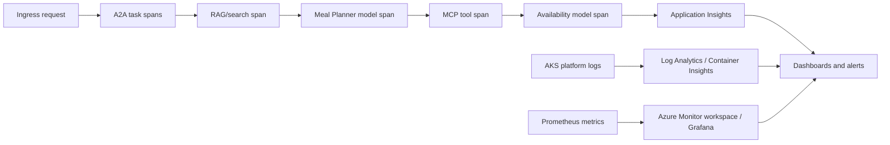

# Security and observability

## Security baseline

### Identity and authorization

- One ServiceAccount, UAMI, blueprint, and Agent ID per agent; no shared identities.
- Azure RBAC applies to UAMIs at the narrowest resource scope. Use data-plane roles rather than broad subscription roles.
- A2A/MCP APIs validate Agent ID tokens and explicit app roles on every request.
- No customer identity is inferred from an anonymous session. Do not use customer text to select credentials or permissions.
- Record owners/sponsors and lifecycle metadata for each Agent ID.

### Network and platform

- Expose the frontend/web API through the PoC's AKS `LoadBalancer` Service or frontend ingress; keep Concierge, Meal Planner, Availability, and Inventory MCP cluster-internal.
- Apply TLS, request-size limits, throttling, and anonymous abuse controls at the selected public endpoint. A WAF-capable Application Gateway or API Management layer is optional future hardening.
- Use AKS network policies with explicit Concierge-to-Meal, Concierge-to-Availability, Availability-to-MCP, DNS, identity, telemetry, Search, and Foundry egress paths.
- The current Bicep deploys a public AKS cluster with a Standard Load Balancer. Private AKS and private endpoints/private DNS for Azure services are optional future production hardening.
- Use non-root, read-only containers, dropped Linux capabilities, seccomp, resource limits, image signing/scanning, and supported AKS versions.
- Store deploy-time configuration in an approved configuration service and secrets in Key Vault; do not log credentials.

### Agent and data safety

- Treat prompts, retrieved documents, A2A payloads, and MCP output as untrusted data.
- Separate system instructions from retrieved content and reject tool instructions embedded in RAG documents.
- Schema-validate every inter-agent and tool message; cap sizes, timeouts, retries, and model/tool budgets.
- Re-resolve every model-selected recipe ID against Search and every substitute SKU against MCP results.
- Keep serving arithmetic, stock quantities, and availability flags outside model control.
- Inventory is read-only. Any future mutation requires user confirmation, idempotency, transaction controls, and a separate app role.
- Minimize retention of anonymous conversation text and avoid collecting special-category data. Redact content before telemetry.
- Preserve RAG source IDs and inventory timestamps so results are explainable.

## Threat-to-control summary

| Threat | Primary controls |
| --- | --- |
| Prompt injection through customer or RAG content | Instruction/data separation, content filtering, tool allowlists, schema validation |
| Agent impersonation | Workload federation, Agent ID tokens, audience/role checks, no shared credentials |
| Lateral movement between agents | Separate identities, API audiences, app roles, network policies |
| Excessive Azure access | Resource-scoped Azure RBAC on each UAMI |
| Fabricated inventory | MCP as sole stock authority, deterministic tools, `asOf` timestamp |
| Sensitive data leakage | Data minimization, redaction, Purview policies, private networking |
| Supply-chain compromise | Trusted registry, Defender scanning, pinned dependencies/images, admission controls |

## Observability design

Instrument Python services with OpenTelemetry and correlate the complete path:

Capture:

- `trace_id`, opaque `correlation_id`, service/agent name, task ID, protocol, downstream audience, and outcome.
- Latency, error/timeout/retry counts, token acquisition failures, `401`/`403`, model token usage, search latency/result count, and MCP tool duration.
- Agent/model/deployment and prompt-template versions, RAG index version, source IDs, inventory snapshot time, and content-filter outcome.
- AKS pod health, restarts, throttling, node pressure, network denials, and identity federation failures.

Do **not** capture bearer tokens, authorization headers, raw ServiceAccount assertions, secrets, full prompt bodies by default, or customer-provided sensitive data. Use sampling and short, policy-approved retention for PoC content.

Recommended stack:

- [Application Insights OpenTelemetry](https://learn.microsoft.com/en-us/azure/azure-monitor/app/opentelemetry-enable) for application traces, metrics, logs, and exceptions.
- [AKS monitoring](https://learn.microsoft.com/en-us/azure/aks/monitor-aks), Container Insights, and Log Analytics for cluster/workload operations.
- [Managed Prometheus](https://learn.microsoft.com/en-us/azure/azure-monitor/metrics/prometheus-metrics-overview) and Azure Managed Grafana for service-level metrics.
- Entra sign-in/audit logs for UAMI, blueprint, and Agent ID events.

## Purview and Defender

**Microsoft Purview** is the data governance and compliance layer. Use [Data Security Posture Management](https://learn.microsoft.com/en-us/purview/data-security-posture-management-learn-about) and the [AI agents guidance](https://learn.microsoft.com/en-us/purview/ai-agents) to discover sensitive-data exposure, apply labels/DLP where applicable, define retention, and support audit/investigation. Confirm feature coverage for custom AKS agents and data sources during implementation; not every control is automatic.

**Microsoft Defender for Cloud** is the cloud workload and posture layer. Enable Defender plans appropriate to AKS, containers, registry, and AI resources; use [AI security posture management](https://learn.microsoft.com/en-us/azure/defender-for-cloud/ai-security-posture) for discovery, recommendations, attack paths, and AI workload posture where supported.

Purview and Defender complement rather than replace Agent ID, Azure RBAC, secure application design, and runtime telemetry. Licensing, region availability, preview status, and connector coverage must be verified for the target tenant.

## Initial alerts

- Sustained A2A/MCP `401` or `403` increase.
- Token acquisition or workload federation failures.
- Unexpected caller Agent ID or API audience.
- New public endpoint, permissive network policy, or high-severity image finding.
- Search/Foundry/MCP error-rate or latency SLO breach.
- Inventory responses missing `asOf` or returning schema errors.
- Abnormal model/tool volume or cost per anonymous session.
